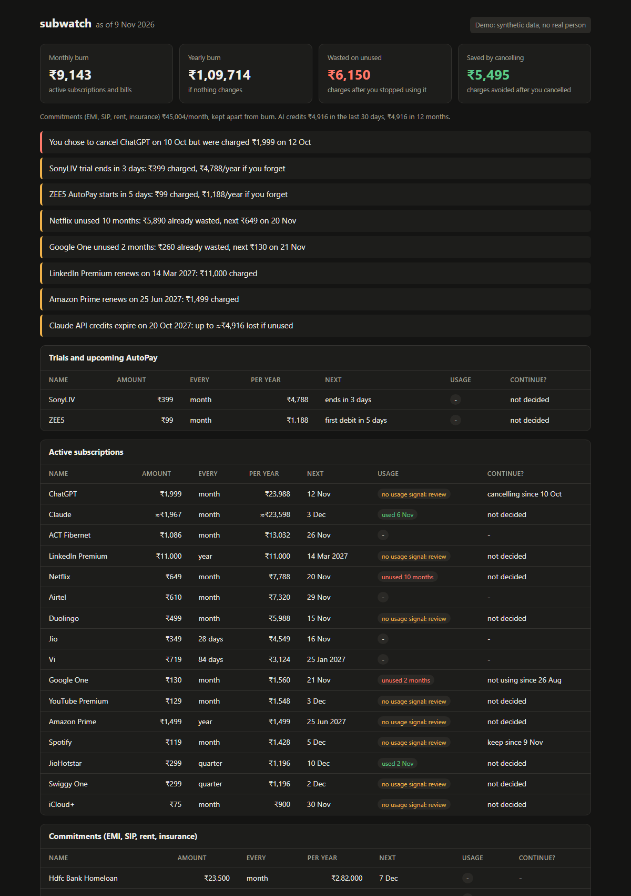

# subwatch

**Find the subscriptions and free trials draining your money, from your Gmail and Indian bank SMS, on your own laptop.**

[](https://github.com/NAMAN-VERMA-02/subwatch/actions/workflows/ci.yml)
**Live demo (synthetic data):** https://naman-verma-02.github.io/subwatch/



Every reminder says what you stand to lose in rupees:

```
Spotify trial ends tomorrow: ₹119 charged, ₹1,428/year if you forget
Google One unused 2 months: ₹260 already wasted, next ₹130 on 15 Nov
You chose to cancel ChatGPT on 1 Nov but were charged ₹1,999 on 5 Nov
Claude API credits expire in 5 days: up to ≈₹4,916 lost if unused
```

…and then asks: **continue or cancel?**

## Why not just open the AutoPay screen in GPay?
GPay, PhonePe and Paytm each show only the mandates made through them. subwatch reads **all** your banks, cards and UPI apps plus your email, so it also finds trials started before any mandate, card subscriptions, and USD charges like Claude or ChatGPT. It also tells you which ones you've stopped using. And it runs locally: your SMS and mail never leave your machine, unlike expense apps that upload them.

## Install
Python 3.10+, no dependencies:

```bash
uv tool install git+https://github.com/NAMAN-VERMA-02/subwatch@v0.1.1
```
(or `pipx install git+https://github.com/NAMAN-VERMA-02/subwatch@v0.1.1`)

## Try it in 30 seconds
```bash
subwatch demo
```
This builds a made-up person's 18 months of mail and SMS, runs the whole pipeline and opens the dashboard. Nothing of yours is read.

## Use it on your own data
1. **Gmail (history):** [Google Takeout](https://takeout.google.com) → *Deselect all* → tick **Mail** → export. Unzip it to get `All mail Including Spam and Trash.mbox`.
2. **Bank SMS (Android):** install *SMS Backup & Restore* → back up **Messages** → copy the `sms-*.xml` file to your PC. If you schedule a daily backup into a folder that syncs to your PC, `subwatch daily` stays current.
3. Run:
```bash
subwatch scan "All mail Including Spam and Trash.mbox" path/to/sms-backup-folder
subwatch report --html dashboard.html --open
subwatch review
subwatch remind --ics reminders.ics
```
Import `reminders.ics` into Google Calendar and your phone does the alerting. Event IDs are stable, so re-importing updates events instead of duplicating them.

**Optional, fresh email without Takeout:** `subwatch scan --imap you@gmail.com` reads Gmail over IMAP with an [app password](https://myaccount.google.com/apppasswords). It is read-only and fetches only receipts, trials and logins since the last run. The password comes from `SUBWATCH_IMAP_PASSWORD` or a prompt and is never stored. This is the only part of subwatch that uses the network, and it talks only to Gmail.

### Every day, automatically
`subwatch daily` rescans your SMS backup folder (and IMAP, when `SUBWATCH_IMAP_PASSWORD` is set). It then refreshes `~/.subwatch/reminders.ics` and `dashboard.html`, and shows a desktop notification for anything due within 2 days.

Windows:
```bash
schtasks /create /sc daily /st 09:00 /tn subwatch /tr "subwatch daily"
```

macOS/Linux (crontab):
```bash
0 9 * * * subwatch daily
```

## Commands
| Command | What it does |
|---|---|
| `subwatch scan FILES/FOLDERS [--imap ADDR]` | Reads exports; incremental, so rescanning adds only new messages |
| `subwatch report [--html F --open]` | Totals, subscriptions, trials, commitments, AI credits |
| `subwatch review` | One by one: **[k]eep / [c]ancel / [n]ot using it / [s]kip** |
| `subwatch mark NAME keep\|cancel\|unused\|ignore\|clear [--on DATE] [--price ₹]` | The same decisions, scriptable |
| `subwatch remind [--ics F] [--notify]` | Reminders as text, a calendar file or desktop toasts |
| `subwatch daily` | Rescan + reminders + dashboard, for Task Scheduler/cron |
| `subwatch demo` | The whole thing on synthetic data |

Options: `--today`, `--unused-days N` (default 30), `--usd-rate` (default 95), `--forex-markup` (default 3.5%).

## How it works
- **Parsing** (`parse.py`) turns each SMS or email into an event: charge, trial, AutoPay mandate, RBI pre-debit notice (banks must send one 24h before a recurring debit), usage, or API credit top-up.
  - It knows HDFC, ICICI, SBI, Axis and Kotak alert styles, `PAYU*`/`RAZ*`-style descriptors, UPI handles, USD card charges, and dd/mm vs mm/dd dates.
  - Payment OTPs, refunds, credits, card-bill payments, UPI Lite top-ups and marketing mail are skipped.
  - Only extracted fields are stored, never message text.
- **Detection** (`detect.py`):
  - One payment seen three times (bank SMS, UPI app, email receipt) counts once. A `GOOGLE PLAY` card charge resolves to the service named in the receipt.
  - Charges split into exact-amount series, so two Google Play subscriptions stay apart while a price hike joins up.
  - Recognised periods are monthly, 28-day and 84-day recharges, quarterly and yearly; one missed cycle is allowed. Bills may vary in amount.
- **Usage** has three levels:
  - **used**: a login email or login OTP SMS within N days.
  - **unused**: the service has sent usage signals before and has now gone quiet.
  - **unknown**: never seen a signal. subwatch asks you in `review` instead of guessing.

  Only evidence, or your own answer, counts toward *wasted*.
- **Money** is integer paise with Indian digit grouping (₹1,00,000):
  - **Burn** covers active subscriptions and bills.
  - **Commitments** (EMI, SIP, rent, insurance) are shown separately so rent doesn't drown the number.
  - **Saved** counts only subscriptions you chose to cancel that then stayed uncharged. One that simply stopped appearing might have moved to another card, so it isn't counted.

## Accuracy
| Data | Subscriptions found | False alarms | Precision | Recall | Trials |
|---|---|---|---|---|---|
| **Synthetic** (seed 7, 2,746 messages, run 2026-11-09) | 20 of 20 | 1 | 95% | 100% | 2 of 2, 0 false |
| **Naman's own Gmail + SMS**, first run (8,775 messages, 2026-11-10) | 0 of 1 | 1 | 0% | 0% | 0 of 0, 3 flagged |
| **Naman's own Gmail + SMS**, after tuning (same data and truth) | 1 of 1 | 1 | 50% | 100% | 0 of 0, 3 flagged |

- **Synthetic** data is made up and was written by the same person as the detector. CI uses it as a regression gate only, so read it as "nothing broke", not as real-world accuracy. Its one false alarm is a monthly transfer to the user's own account, which `subwatch mark … ignore` hides.
- **Real data:** the ground truth is frozen *before* the detector runs. It comes from the UPI AutoPay lists, card standing instructions and Play Store subscriptions, so anything subwatch misses still counts against it. Only anonymised counts are committed (`eval/real/`).
- **Real data, read this before the percentages:** n = 1. The frozen truth lists one active subscription (YouTube Premium, ₹89/month).
  - **The first run missed it.** Its renewal date slipped twice (the 18th, then the 30th, then the 5th), and the cadence check rejected the 43-day gap. The bank SMS also called it "Google" with nothing to tie it to the YouTube receipts.
  - **After tuning:**
    - Slipped renewals are accepted when most gaps are a single cycle.
    - UPI AutoPay "to Google" is treated as Play billing.
    - #9 (a PNB pre-debit bug found on this data) is fixed.
  - **The four "false alarms" are real.** They were checked by hand after the run: a Claude ₹1,999 plan, Google One and LinkedIn Premium trials, and the Play AutoPay behind Claude. All four had already been discontinued, so they are absent from a truth list of *active* subscriptions. subwatch shows Claude as active because its next due date (11 Nov) hasn't passed yet; `mark claude cancel` fixes that.
  - This data was redacted before the run (names, phone, account and reference numbers, OTPs and personal emails were removed; personal chats were dropped).
  - Files: `eval/real/truth.anon.csv` (committed before the run), `results.json` (first run), `results.after-tuning.json`.
- Reproduce: `python eval/run.py --synthetic`.
- Scan speed: 148 messages/s on 20,320 synthetic emails (8 MB). That was measured on the author's Windows laptop while it was busy with other jobs, so treat it as a floor. A large Takeout is a one-time import; later scans only add new messages. Measure yours with `python eval/run.py --bench 20000`.

## Limitations
- Usage evidence depends on what services choose to email or SMS. Many never send login emails, which is why "unknown" exists.
- The real-data numbers come from one person's phone and inbox with a single active subscription, so they show behaviour on real message formats, not a statistically meaningful rate; anonymised message formats from others are welcome (see Contributing).
- Not covered:
  - RCS bank messages (SMS backups don't include them)
  - iPhone SMS (export to CSV with a tool like iMazing; untested)
  - currencies other than INR/USD
  - weekly plans

## Contributing
Found a bank SMS or receipt that subwatch misread? Open a [missed detection](https://github.com/NAMAN-VERMA-02/subwatch/issues/new/choose) issue with the message **anonymised**. Questions go to [Discussions](https://github.com/NAMAN-VERMA-02/subwatch/discussions/categories/q-a).

## License
MIT © 2026 Naman Verma
